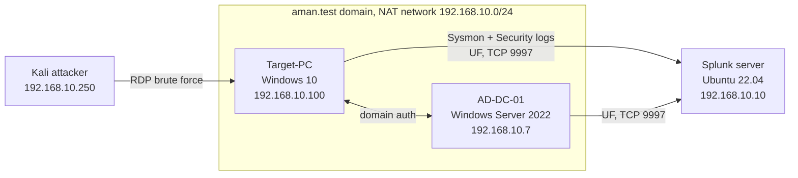

# SOC Active Directory Home Lab: Attack and Detection with Splunk


An isolated Active Directory environment where I attack a domain-joined workstation, then switch to the defender's
seat and find the attack in Splunk. It covers the full loop: build the network, collect telemetry, generate malicious
activity, and write detections for it.

## What it does

1. Builds a four-machine domain on a private VirtualBox network.
2. Ships Windows Security and Sysmon logs to Splunk using the Universal Forwarder.
3. Runs an **RDP brute-force** from Kali and **Atomic Red Team** techniques on the workstation.
4. Detects each one with Splunk searches and maps them to MITRE ATT&CK.



## Lab machines

| Machine | OS | Role | IP |
| :--- | :--- | :--- | :--- |
| Splunk-Server | Ubuntu Server 22.04 | SIEM | 192.168.10.10 |
| AD-DC-01 | Windows Server 2022 | Domain controller | 192.168.10.7 |
| Target-PC | Windows 10 | Domain-joined workstation (victim) | 192.168.10.100 |
| Attacker-Kali | Kali Linux | Attacker | 192.168.10.250 |

All addresses are private (`192.168.10.0/24`) and exist only inside the VirtualBox NAT network.

## Detections

| Activity | Technique | Primary data source | Query |
| :--- | :--- | :--- | :--- |
| RDP password guessing | [T1110.001](https://attack.mitre.org/techniques/T1110/001/), [T1021.001](https://attack.mitre.org/techniques/T1021/001/) | Security 4625 then 4624 | [queries 1 and 2](detections/splunk-queries.md) |
| Local account creation | [T1136.001](https://attack.mitre.org/techniques/T1136/001/) | Security 4720, Sysmon process creation | [queries 3 and 4](detections/splunk-queries.md) |
| Suspicious PowerShell | [T1059.001](https://attack.mitre.org/techniques/T1059/001/) | Sysmon process creation | [query 5](detections/splunk-queries.md) |

<!--
RESULTS: uncomment this section after adding the screenshots listed in evidence/README.md

## Results

| What | Proof |
| :--- | :--- |
| Burst of failed logons (4625) |  |
| Successful logon from attacker IP |  |
| Brute-force correlation search |  |
| New account found via Atomic test |  |
-->

## Build it yourself

1. [Architecture and network plan](docs/00-architecture.md)
2. [Virtualization setup](docs/01-virtualization.md)
3. [Splunk server](docs/02-splunk-server.md)
4. [Windows telemetry: Sysmon and Universal Forwarder](docs/03-windows-telemetry.md)
5. [Active Directory](docs/04-active-directory.md)
6. [Attack simulation](docs/05-attack-simulation.md)
7. [Detection engineering](docs/06-detection-engineering.md)

## Repository layout

```
docs/          step-by-step build guides
detections/    Splunk searches (copy and paste)
evidence/      screenshots (see evidence/README.md)
```

## Safety and ethics

This lab runs real attack tooling. Keep every VM on the isolated NAT network, use throwaway passwords that appear
nowhere else in your life, and only attack machines you built yourself. See [`docs/05`](docs/05-attack-simulation.md).

## Credits

Built following the MyDFIR Active Directory lab series. The detection searches, MITRE mapping and the corrections to
the Atomic Red Team steps are my own additions.

<details>
<summary>Reference videos (7)</summary>

- [Part 1](https://www.youtube.com/watch?v=5OessbOgyEo&list=PLG6KGSNK4PuBWmX9NykU0wnWamjxdKhDJ&index=13)
- [Part 2](https://www.youtube.com/watch?v=mWqYyl89QaY&list=PLG6KGSNK4PuBWmX9NykU0wnWamjxdKhDJ&index=14)
- [Part 3](https://www.youtube.com/watch?v=2cEj3bS5C0Q&list=PLG6KGSNK4PuBWmX9NykU0wnWamjxdKhDJ&index=15)
- [Part 4](https://www.youtube.com/watch?v=uXRxoPKX65Q&list=PLG6KGSNK4PuBWmX9NykU0wnWamjxdKhDJ&index=16)
- [Part 5](https://www.youtube.com/watch?v=1XeDht_B-bA&list=PLG6KGSNK4PuBWmX9NykU0wnWamjxdKhDJ&index=17)
- [Part 6](https://www.youtube.com/watch?v=orq-OPIdV9M&list=PLG6KGSNK4PuBWmX9NykU0wnWamjxdKhDJ&index=18)
- [Part 7](https://www.youtube.com/watch?v=VnvgfQEv7Jo&list=PLG6KGSNK4PuBWmX9NykU0wnWamjxdKhDJ&index=19)

</details>

## License

[MIT](LICENSE)
