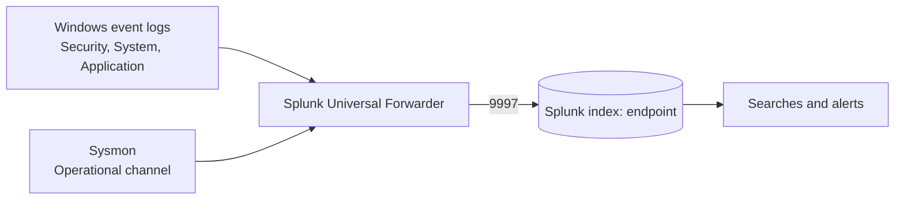

[Back to README](../README.md)

# 00. Architecture and Network Plan

## Machines

| Machine | OS | Role | Static IP |
| :--- | :--- | :--- | :--- |
| Splunk-Server | Ubuntu Server 22.04 | SIEM: stores and searches logs | 192.168.10.10 |
| AD-DC-01 | Windows Server 2022 | Domain controller for `aman.test` | 192.168.10.7 |
| Target-PC | Windows 10 | Domain-joined workstation (victim) | 192.168.10.100 |
| Attacker-Kali | Kali Linux | Attacker | 192.168.10.250 |

## Network

| Setting | Value |
| :--- | :--- |
| VirtualBox network type | NAT Network named `AD-Project` |
| IPv4 prefix | `192.168.10.0/24` |
| Gateway | `192.168.10.1` (virtual router) |
| Domain | `aman.test` |

A NAT Network gives every VM internet access through the host while keeping them off your real LAN. VMs on the same
NAT Network can talk to each other, which is exactly what the attack needs.

## Ports in use

| Port | From | To | Purpose |
| :-: | :--- | :--- | :--- |
| 9997/tcp | Target-PC, AD-DC-01 | Splunk-Server | Universal Forwarder log shipping |
| 8000/tcp | Your host | Splunk-Server | Splunk web UI |
| 3389/tcp | Kali | Target-PC | RDP (attack target) |

## Data flow

Everything lands in a single index, `endpoint`, so detections can correlate Windows and Sysmon data in one search.
